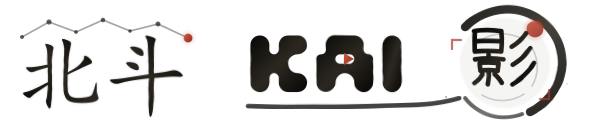

<p align="center">
  
</p>

<h1 align="center">北斗 KAI影</h1>

<p align="center">把一个想法，推进下一场戏</p>

<p align="center">
  <a href="VERSION"></a>
  <a href="LICENSE"></a>
  
  
</p>

北斗 KAI影是一套面向 AI 影视、短剧与视觉内容创作的工作台。它把故事梳理、镜头设计、角色资产、图片/视频/音频生成、素材管理和自由画布放进同一条创作流程，让创作者从一句描述出发，逐步形成可以继续编辑和复用的镜头资产。

- 在线入口：[https://simon.kai.com/kai/](https://simon.kai.com/kai/)
- GitHub：[xum74526-art/kai--](https://github.com/xum74526-art/kai--)

> 项目仍处于快速开发阶段，数据结构和模型渠道合同可能继续调整。当前更适合个人、本地或可信环境部署；公网使用前必须完成 HTTPS、CORS、管理员初始化、存储权限和备份配置。

## 核心能力

- **创作工作台**：从文本、参考图或已有素材开始，统一选择文本、图片、视频和音频模型。
- **自由画布**：支持节点编排、连线、分组、导入导出、公开只读分享和生成结果回写。
- **影视工作流**：管理故事、章节、角色、镜头、分镜、声音与可复用的风格资产。
- **任务与素材**：后端异步生成队列、任务状态、失败信息、素材版本与资源归属管理。
- **Agent 协作**：网页画布助手、本地 Canvas Agent、技能库与 Codex 工作流。
- **模型 API**：统一接入文本、图片、视频、音频渠道，并支持系统渠道和用户自定义渠道。
- **管理能力**：用户、积分、模型渠道、价格、并发、资源配额、公告和运行策略管理。
- **私有存储**：支持后端文件存储、阿里云 OSS、腾讯云 COS 和七牛云 Kodo。

## 技术栈

| 模块 | 技术 |
| --- | --- |
| Web | Vite、React 19、TypeScript、React Router、Ant Design、Tailwind CSS、Zustand、TanStack Query |
| Backend | Go、Gin、GORM、SQLite / PostgreSQL、Redis |
| Canvas Agent | Bun / Node.js、MCP、Codex CLI |
| Deployment | Docker Compose、Nginx、HTTPS 反向代理 |

## 目录结构

```text
web/            Web 前端
backend/        Go API、任务与数据服务
canvas-agent/   本地画布 Agent
plugins/        Codex 与画布插件
deploy/         部署模板
docs/           设计与开发文档
```

## 本地运行

需要准备 Bun、Go 1.25+ 和 Git。

```bash
git clone https://github.com/xum74526-art/kai--.git kai
cd kai
```

启动后端。开发数据必须保存在 Git 忽略的 `.local/project-workbench-debug`：

```bash
mkdir -p .local/project-workbench-debug
cd backend
CANVAS_BACKEND_DATA_DIR=../.local/project-workbench-debug go run ./cmd/server
```

Windows PowerShell 可使用：

```powershell
New-Item -ItemType Directory -Force .local/project-workbench-debug | Out-Null
Set-Location backend
$env:CANVAS_BACKEND_DATA_DIR = "../.local/project-workbench-debug"
go run ./cmd/server
```

另开终端启动前端：

```bash
cd web
bun install
bun run dev
```

打开 [http://localhost:3000](http://localhost:3000)。模型渠道、存储和运行策略在登录后的管理界面配置。

## 管理员与注册

- 当前注册流程创建的是普通用户，不会把第一个注册账号自动提升为管理员。
- 已有部署应迁移并保护现有管理员数据库，不要通过开放公网注册来初始化管理员。
- 全新空数据库的受控管理员初始化流程仍需完善；完成前不建议把源码一键部署描述为可直接投入公网使用。
- 公网开放注册时应同时启用邮箱验证、频率限制、资源配额和模型调用预算。
- 管理员权限必须由后端校验，不能只依赖前端隐藏入口。

## 部署与安全

Docker 配置位于仓库根目录，Simon 子路径部署说明见 [`deploy/simon/README.md`](deploy/simon/README.md)。部署前至少确认：

1. 只对外暴露 Web 入口，后端服务留在容器网络内。
2. 使用 HTTPS，并保留 `Host`、`X-Forwarded-For` 和 `X-Forwarded-Proto`。
3. 为 `CANVAS_CORS_ORIGINS` 配置明确的前端 Origin，不在公网使用 `*`。
4. 保护数据库、上传目录、备份和 `.settings-key`，并建立可恢复的定期备份。
5. 仅对文本 SSE 路径关闭代理缓冲，不把长超时设置复制到全部 API。
6. 自定义模型渠道仅连接可信 HTTPS 上游，避免把 API Key 暴露给浏览器、日志或 URL。

## 数据边界

- 用户自定义模型 API Key 保存在浏览器本地；任务创建时可能提交给自部署后端，因此必须使用可信部署和 HTTPS。
- 画布和素材登录后同步到后端，浏览器本地存储继续承担缓存和后端不可用时的降级。
- 媒体资源可保存到私有 OSS/COS/Kodo 或后端文件目录；删除素材前会检查项目、画布、任务和其他业务引用。
- SQLite 数据库、真实 `.env`、密钥、缓存、上传文件和发布快照均不应提交到 Git。

## 开发命令

```bash
# 前端开发
cd web && bun run dev

# 前端构建
cd web && bun run build

# 前端测试
cd web && bun test

# 后端开发
cd backend && CANVAS_BACKEND_DATA_DIR=../.local/project-workbench-debug go run ./cmd/server
```

## 项目文档

- [更新日志](CHANGELOG.md)
- [安全策略](SECURITY.md)
- [贡献指南](CONTRIBUTING.md)
- [行为准则](CODE_OF_CONDUCT.md)
- [上游与第三方声明](NOTICE)
- [本地 Canvas Agent](canvas-agent/README.md)
- [Simon 部署说明](deploy/simon/README.md)

## 上游与许可证

北斗 KAI影是在 Open AI Canvas 及其上游 [basketikun/infinite-canvas](https://github.com/basketikun/infinite-canvas) 基础上进行的二次开发。原项目、上游作者及贡献者的版权和署名继续按 [`LICENSE`](LICENSE) 与 [`NOTICE`](NOTICE) 保留。

项目采用 MIT License。提交安全问题前请先阅读 [`SECURITY.md`](SECURITY.md)。
